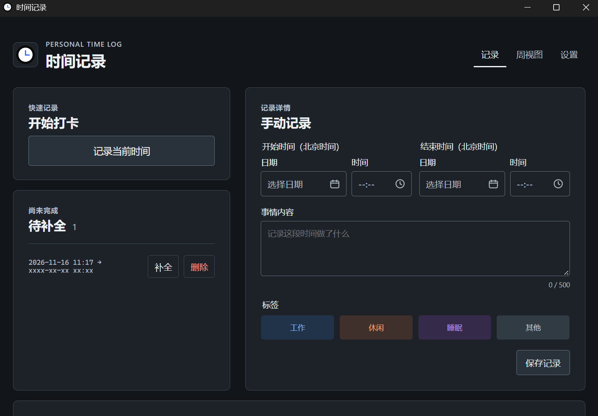
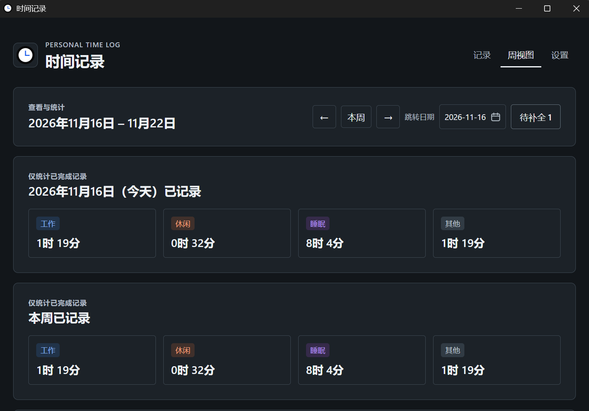
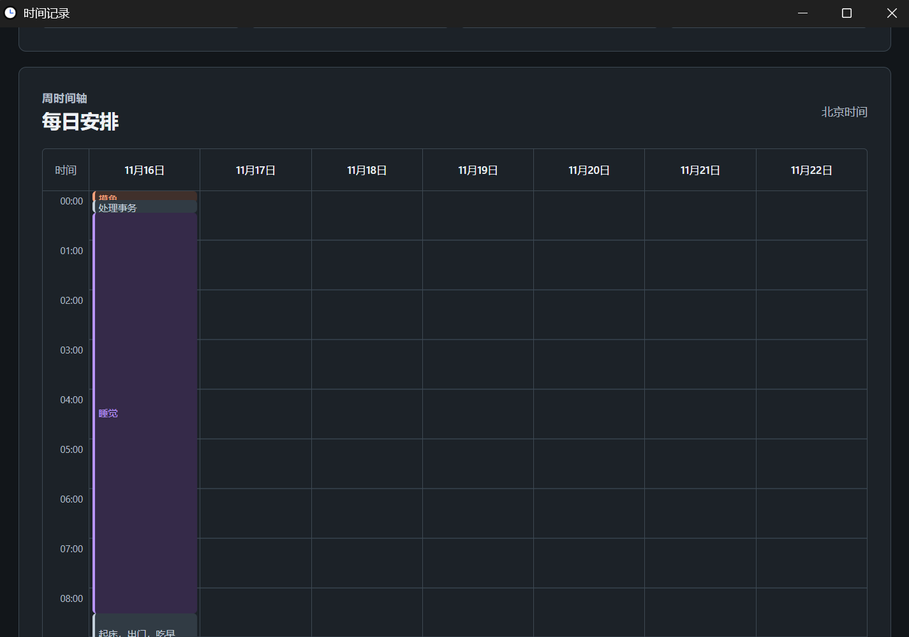

<p align="center"></p>

# Time

本地优先的时间记录应用：把每天的时间按「工作 / 娱乐 / 睡觉 / 其他」四类记下来，按周回看时间花在哪。

桌面端基于 Tauri 2、Vue 3 与 Rust，记录保存在本机 SQLite 数据库；可选填入同步码，与网页版共用同一份云端数据。界面与统计统一按北京时间，存储使用 UTC 毫秒，跨月、跨年浏览都按同一套区间规则计算。

## 下载与使用

| 平台 | 获取 | 首次使用 |
| --- | --- | --- |
| Windows 10/11 x64 | [Releases](https://github.com/ZGZLCC/time/releases/latest) 里的 `Time_<版本>_x64-setup.exe` | 安装包未做代码签名，SmartScreen 提示时选「更多信息 → 仍要运行」；支持当前用户与全用户两种安装范围，重装时沿用原范围与目录 |
| macOS 11+（Apple Silicon） | [Releases](https://github.com/ZGZLCC/time/releases/latest) 里的 `Time_<版本>_aarch64.dmg` | 双击 dmg 后把 Time 拖进「应用程序」；未签名与公证，首次打开需在「系统设置 → 隐私与安全性」里点「仍要打开」 |
| 网页版 | <https://zgzlcc.github.io/time> | 记录存在浏览器 IndexedDB，不填同步码时完全本地运行 |

桌面端与网页版共用同一个同步服务与同一套记录契约：一个同步码对应一份独立数据，换设备填入同一个码即可拉回全部记录。

## 界面

<p align="center"></p>

<p align="center">
  
  
</p>

## 功能

- **记录**：手动填写起止日期与时间、快速打卡（只记开始时间）、草稿补全、编辑与删除；已完成记录之间禁止时间重叠，冲突时保留输入并提示对应记录
- **时间控件**：自绘七列日历（周一起始、固定 6 行）与小时／分钟双列滚动选择器（两列都能无限循环，打开时落在当前时刻），不使用系统默认日期时间控件
- **周视图**：七天 00:00–24:00 网格，跨午夜记录按天拆分；「选中日期已记录 / 本周已记录 / 累计记录」三张四类时长卡片；点击时间块滚动到上方详情并可进入编辑
- **历史**：默认列出全部已完成记录，可按日期跳转只看某天（跨午夜记录计入它覆盖的每一天）
- **导出**：周时间表与本周分类时长导出 PNG，图片使用固定配色，亮色与暗色下逐字节一致
- **备份与恢复**：SQLite 在线备份导出、从备份整体恢复、软删除清空记录；恢复会整体替换当前记录，替换前不会自动留快照，建议先导出一份备份
- **主题**：跟随系统、亮色、暗色三态，选择保存在本机
- **云同步**：「立即同步」逐条合并（后写胜出）、「上传本地记录」整体覆盖云端、「从云端恢复」整体覆盖本机；删除通过墓碑传到其他设备

## 数据与隐私

- 记录默认在应用数据目录：Windows 为 `%APPDATA%\com.time.tracker\time-v3.sqlite3`，macOS 为 `~/Library/Application Support/com.time.tracker/time-v3.sqlite3`
- 未填写同步码时不向任何服务器发送数据，应用不含统计、埋点或自动更新检查
- 时间以 UTC 毫秒存储，界面与统计按北京时间（UTC+8）展示，系统时区变化不影响历史记录
- 数据库升级（schema 变化）前按版本留下 `.v{N}.bak` 快照，迁移失败整体回滚，不以删库重建处理异常
- 备份导出默认落在系统下载文件夹，重名时自动加序号、不覆盖已有文件

## 本地部署

环境要求：Node.js 20.19+（或 22）、Rust stable；Windows 另需 MSVC 构建工具与 WebView2，macOS 另需 Xcode Command Line Tools。

```bash
npm ci                 # 安装锁定版本的前端依赖
npm run tauri -- dev   # 启动桌面开发窗口
```

构建与检查：

```bash
npm run build        # TypeScript 类型检查 + 前端生产构建
npm run test:time    # 17 项 Node 检查：北京时间、单日区间、记录历史、日历计算
cargo test --manifest-path src-tauri/Cargo.toml --locked   # 50 项 Rust 检查
```

打包：

- Windows：`npm run tauri -- build`，安装包输出到 `src-tauri/target/release/bundle/nsis/`
- macOS：`.github/workflows/macos-build.yml` 在 GitHub Actions 的 `macos-15`（Apple Silicon）上构建 `.app` 与 `.dmg`
- 发布：推送 `v*` 标签时 `.github/workflows/release.yml` 在两端 runner 上构建安装包，并附到对应的 Release

## 项目结构

Vue 前端负责界面与交互，Rust 后端作为时间规则、重叠校验和统计的唯一来源。界面代码在 `src/`，Tauri 命令、时间区间规则与 SQLite 访问在 `src-tauri/`。完整目录与文件职责见 [项目结构与代码功能](docs/project-structure.md)。

## 文档

- [执行方案](docs/implementation-plan.md)：数据规则、本地命令接口与分阶段验收标准
- [项目结构](docs/project-structure.md)：目录清单与每个文件的职责
- [前端设计规范](docs/DESIGN-webflow.md)：配色、字体、间距与组件规则
- [开发规范](docs/AGENTS.md)：模块边界、代码长度与验证要求
- [macOS 验证清单](docs/macos-验证清单.md)：在 Mac 上逐项验收的操作单

## 网页版

网页版与桌面版共用同一套记录契约与同步服务，记录保存在浏览器 IndexedDB，未配置云端时完全本地运行。它随相册站点仓库 `Momo` 的 `web/` 目录维护，发布在 <https://zgzlcc.github.io/time>。国内直连 `*.workers.dev` 会被 DNS 污染，不挂代理时同步不可用，但不影响本地记录。

## 许可证

[MIT](LICENSE)
